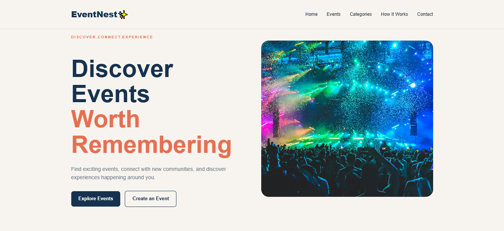
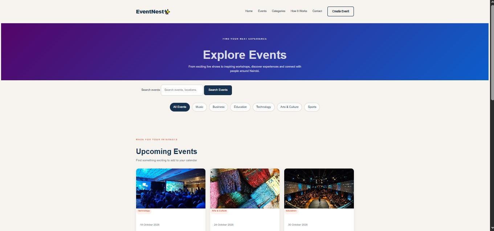
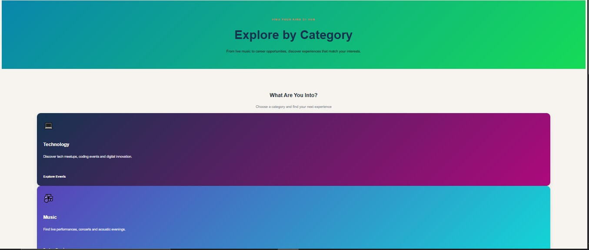
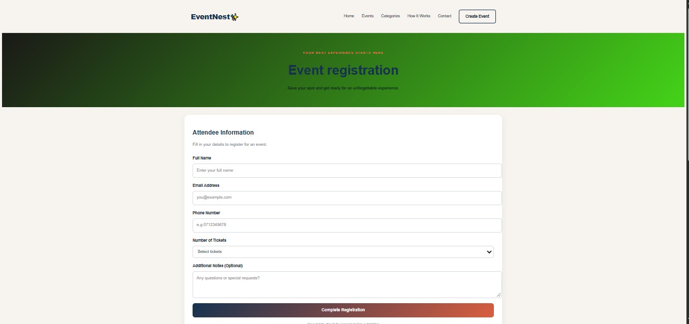

# EventNest ✨

### Discover Events. Explore Experiences. Create Memories.

## 1. Project Overview

**EventNest** is a responsive event discovery website designed to help users find, explore, and register for events that match their interests. The platform brings different types of events together in one place, making it easier for users to discover activities and for organizers to introduce their events to a wider audience.

The website includes an engaging homepage, event listings, event categories, event details, registration forms, and an event submission page. It also provides information about how the platform works and a contact page for visitors.

EventNest was developed as a web development capstone project to demonstrate the use of HTML and CSS in building a structured, visually appealing, and responsive multi-page website.

## 2. Problem Statement

Information about events is often scattered across different websites and social media platforms. This can make it difficult for people to discover events that interest them, compare available activities, and find registration information.

Event organizers may also find it challenging to present their events in an organized way where potential attendees can easily discover them.

## 3. Proposed Solution

EventNest provides a centralized platform where users can explore different events, browse events by category, view event information, and access registration forms.

The website also includes an event submission page that provides organizers with a place to enter their event information. Through its organized layout and responsive design, EventNest aims to make event discovery easier and more accessible across different screen sizes.

## 4. Project Objectives

- To create a user-friendly platform for discovering events.
- To organize event information into clear listings and categories.
- To provide event registration and confirmation pages.
- To create a page where organizers can submit event information.
- To develop a consistent design across multiple web pages.
- To apply responsive design principles for desktop, tablet, and mobile screens.
- To practice semantic HTML, CSS layouts, reusable styling, and website navigation.

## 5. Features and Functionality

### Homepage

The homepage introduces the EventNest platform and guides visitors toward discovering events. It includes a navigation bar, a hero section, statistics, featured event cards, a section explaining how the platform works, testimonials, a call-to-action section, and a footer.

### Events Page

The events page presents available events using a card-based layout. Each card can display event imagery and relevant event information, helping visitors browse the available activities.

### Event Details Page

This page provides a dedicated location for presenting information about a selected event. It is intended to help visitors learn more before proceeding to registration.

### Event Registration Page

The registration page provides a form for visitors to enter the information required to register for an event.

### Confirmation Page

The confirmation page displays a registration confirmation message after the visitor submits the registration form.

### Event Categories Page

The categories page organizes events into different interest areas, making it easier for visitors to explore the types of events they prefer.

### Create Event Page

The create-event page provides a form where organizers can enter information about an event they would like to submit.

### How It Works Page

This page explains the platform's process through organized sections for attendees and event organizers.

### Contact Page

The contact page provides a dedicated area for visitors to find contact information or submit an inquiry through the available form.

### Responsive Design

The website uses CSS layout techniques and media queries to adjust elements for different screen sizes. The design aims to keep navigation, content, event cards, and forms usable on both desktop and smaller screens.

## 6. Technologies Used

- **HTML5:** Used to structure the website content and create the individual pages, forms, navigation, and content sections.
- **CSS3:** Used to style the website, including colors, typography, spacing, backgrounds, gradients, cards, hover effects, transitions, and responsive layouts.
- **CSS Grid and Flexbox:** Used to arrange content, including event cards and other page sections.
- **CSS Media Queries:** Used to adapt layouts for different screen widths.
- **Visual Studio Code:** Used as the development environment.
- **Live Server:** Used to preview and test the website locally in a browser.
- **Git and GitHub:** Used for version control and project hosting.

## 7. Design and User Interface

EventNest uses a consistent visual style across its pages to create a recognizable and organized experience.

The design incorporates the following elements:

- A cream-colored background to create a clean and welcoming appearance.
- Navy blue for strong headings and visual contrast.
- Coral and orange accents to draw attention to important elements.
- Event cards to organize information into manageable sections.
- Gradients to add visual interest to selected sections and cards.
- Hover effects and transitions to make interactive elements feel more responsive.
- Consistent navigation and footer styling across the website.
- Responsive layouts to support different devices and screen sizes.

## 8. Project Structure

The project is organized into individual HTML files, a shared stylesheet, and an image directory.

```text
EventNest/
├── index.html
├── events.html
├── event-details.html
├── register.html
├── confirmation.html
├── create-event.html
├── categories.html
├── how-it-work.html
├── contact.html
├── style.css
├── images/
├── screenshots/
└── README.md
```

**File descriptions**

- `index.html` — Main landing page for EventNest.
- `events.html` — Displays the available events.
- `event-details.html` — Contains the event details layout.
- `register.html` — Contains the event registration form.
- `confirmation.html` — Displays the registration confirmation page.
- `create-event.html` — Contains the event submission form for organizers.
- `categories.html` — Displays the different event categories.
- `how-it-work.html` — Explains how the platform works.
- `contact.html` — Contains the contact page.
- `style.css` — Shared stylesheet for the website's design and responsive layouts.
- `images/` — Stores the images used throughout the website.
- `screenshots/` — Stores screenshots used to demonstrate the project in this README.
- `README.md` — Provides the project's documentation.

## 9. Screenshots

The screenshots below demonstrate the visual design and main pages of EventNest.

### Homepage



### Events Page



### Categories Page



### Registration Page



## 10. How to Run the Project Locally

Follow these steps to view the website on your computer.

1. Download or clone the EventNest repository from GitHub.
2. Open Visual Studio Code.
3. Select **File → Open Folder** and open the EventNest project folder.
4. Ensure the HTML files, `style.css`, and required image files are in the correct locations.
5. Install the Live Server extension in VS Code if it is not already installed.
6. Open `index.html`.
7. Right-click inside the file and select **Open with Live Server**.
8. The website should open in your default browser.

You can navigate through the website using the navigation links and buttons provided on each page.

## 11. Current Limitations

EventNest is a front-end capstone project. Some features may be limited to their visual presentation and basic HTML behavior.

- Event listings may use sample or static content.
- Event search and filtering may require JavaScript to work dynamically.
- Registration forms do not automatically store submissions in a database.
- The event submission form does not publish events to a shared database.
- User accounts, authentication, and online payments are not implemented unless added separately.

These limitations identify areas where the project could be extended in the future.

## 12. Future Improvements

Possible future improvements include:

- Implement functional event search and category filtering.
- Connect registration forms to a database.
- Add user accounts and secure authentication.
- Allow organizers to create, edit, and manage their events.
- Add event booking management and attendee lists.
- Integrate online payment options for paid events.
- Add email confirmations for successful registrations.
- Improve accessibility and conduct additional testing across browsers and devices.

## 13. Learning Outcomes

This project provides practical experience in:

- Structuring multi-page websites with HTML5.
- Applying CSS to create a consistent visual identity.
- Using Grid and Flexbox to arrange website content.
- Implementing responsive layouts with media queries.
- Styling forms, cards, navigation bars, and buttons.
- Using gradients, transitions, and hover effects.
- Organizing project files and linking multiple pages.
- Testing website behavior using a local development server.
- Documenting a project and managing source code with GitHub.

## 14. Author

Anne Ng'endo

Software Engineering Student
